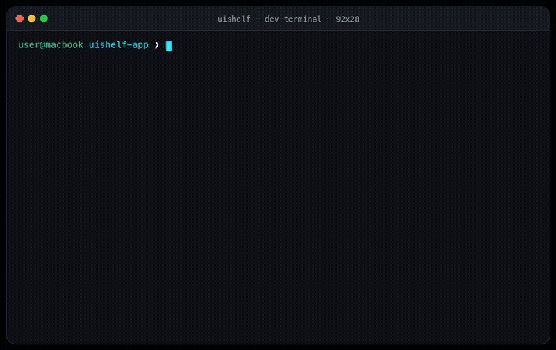

<p align="center">
  
</p>

<h1 align="center">UIShelf</h1>

<p align="center">
  <strong>Universal React UI Registry, Discovery Engine, Compatibility Resolver, Installer & MCP Platform</strong>
</p>

<p align="center">
  <a href="https://github.com/SH20RAJ/uishelf/actions"></a>
  <a href="https://www.npmjs.com/package/uishelf"></a>
  <a href="https://sh20raj.github.io/uishelf/"></a>
  <a href="https://github.com/SH20RAJ/uishelf/blob/main/LICENSE"></a>
  <a href="https://github.com/SH20RAJ/uishelf/stargazers"></a>
  <a href="https://github.com/SH20RAJ/uishelf/pulls"></a>
  
  
</p>

<p align="center">
  <a href="https://sh20raj.github.io/uishelf/"><strong>🌐 Explore Live Web Catalog</strong></a> • 
  <a href="https://sh20raj.github.io/uishelf/docs/"><strong>📚 Documentation</strong></a> • 
  <a href="https://sh20raj.github.io/uishelf/compare/"><strong>⚖️ Compare UI Systems</strong></a> • 
  <a href="https://sh20raj.github.io/uishelf/mcp/"><strong>🤖 MCP Server Guide</strong></a>
</p>

<p align="center">
  
</p>

---

## 💡 What is UIShelf?

**UIShelf is NOT another UI component library.**  
UIShelf is the **resolution layer and universal discovery engine** between developers and the entire React UI ecosystem.

Rather than maintaining a hardcoded catalog, UIShelf operates as a **dynamic multi-platform aggregator and search proxy**. When you search, it queries remote platforms concurrently using their native schemas and endpoints. When you install, it executes their upstream CLI commands in the background while giving you a single, unified `uishelf add` interface!

> **Core Promise**:  
> Search every great UI source → Understand compatibility → Preview & inspect → Choose the best component → Install safely.

Everything runs on the exact same core engine across all interfaces:
- 🌐 **Web Platform**: Interactive search catalog, preview drawer, provider analytics, library comparison (`/compare`).
- ⚡ **Interactive CLI (`uishelf`)**: Instant component discovery, dry-run install plans, doctor diagnostics, smart add.
- 🤖 **Model Context Protocol (MCP)**: Native stdio & remote tools allowing Cursor, Claude, Antigravity, and Windsurf AI agents to safely discover, inspect, and install UI components.

---

## ⚡ Dynamic Multi-Platform Aggregation & Background Execution

1. **Remote Search Proxy**: Searching e.g. `uishelf search button` queries official shadcn registries (`/r/index.json`), Magic UI, Aceternity, 21st, React Bits, Ruixen, Cult UI, ReUI, Kokonut UI, and NPM package registries in parallel with an automatic 2.5s network timeout and instant local caching.
2. **Unified Developer Interface**: You only ever need to run:
   ```bash
   uishelf add <component-id>
   ```
3. **Native Commands Run in Background**: UIShelf runs the upstream provider's native command in the background (`npx shadcn@latest add ...`, `pnpm add @mui/material ...`, `npx 21st@latest add ...`) adapted to your package manager (`pnpm dlx`, `bunx --bun`, or `npx`).
4. **Automatic Transactional Fallback**: If the upstream CLI tool fails or if you are offline, UIShelf automatically falls back to its built-in transactional file and dependency installer, ensuring installations never fail!

---

## 📦 Supported Libraries & Discovery Matrix

Inspect all supported libraries directly in your terminal via `uishelf providers list` or `uishelf libs`:

| Library / Registry | Type | Search Schema / Endpoint | Background Install Command | Stacks Supported | Key Capabilities |
| :--- | :--- | :--- | :--- | :--- | :--- |
| **shadcn/ui** | `shadcn-registry` | Remote Index (`https://ui.shadcn.com/r/index.json`) | `npx shadcn@latest add {name} --yes` | Tailwind v3/v4, React 19, Radix | WAI-ARIA Accessible, Zero-runtime CSS |
| **Magic UI** | `shadcn-registry` | Remote Index (`https://magicui.design/r/index.json`) | `npx shadcn@latest add "https://magicui.design/r/{name}.json" --yes` | Tailwind v3/v4, React 19, Motion | 200+ Animated items, Canvas shaders, Bento |
| **Aceternity UI** | `shadcn-registry` | Remote Index (`https://ui.aceternity.com/r/index.json`) | `npx shadcn@latest add "https://ui.aceternity.com/r/{name}.json" --yes` | Tailwind v3/v4, React 19, Motion | Radiant Hero sections, 3D Pin, Lamp effect |
| **21st.dev** | `cli` | Marketplace API (`https://21st.dev/api/registry/index`) | `npx 21st@latest add {name}` | Tailwind v3/v4, React 19, Motion | Marketplace, Creator registry, Multi-style |
| **React Bits** | `shadcn-registry` | Remote Index (`https://reactbits.dev/r/index.json`) | `npx shadcn@latest add "https://reactbits.dev/r/{name}.json" --yes` | Tailwind v3/v4, React 19, Motion | Physics text, Magnetic cursor, Ballpit |
| **Ruixen UI** | `shadcn-registry` | Multi-Stack API (`https://ruixen.com/r/index.json`) | `npx shadcn@latest add "https://ruixen.com/r/{name}" --yes` | Tailwind v4/v3, Radix, Base UI | Multi-stack variant selector |
| **Cult UI** | `shadcn-registry` | Remote Index (`https://cult-ui.com/r/index.json`) | `npx shadcn@latest add "https://cult-ui.com/r/{name}.json" --yes` | Tailwind v3/v4, React 19, Motion | Tactile neumorphism, Cyberpunk blocks |
| **ReUI** | `shadcn-registry` | Remote Index (`https://reui.io/r/index.json`) | `npx shadcn@latest add "https://reui.io/r/{name}.json" --yes` | Tailwind v3/v4, React 19 | SaaS hero blocks, Notification banners |
| **Animate UI** | `shadcn-registry` | Remote Index (`https://animate-ui.com/r/index.json`) | `npx shadcn@latest add "https://animate-ui.com/r/{name}.json" --yes` | Tailwind v3/v4, React 19, Motion | Spring physics primitives, Morphing dialogs |
| **Kokonut UI** | `shadcn-registry` | Remote Index (`https://kokonutui.com/r/index.json`) | `npx shadcn@latest add "https://kokonutui.com/r/{name}.json" --yes` | Tailwind v3/v4, React 19, Lucide | AI prompt inputs, Interactive commands |
| **MUI (Material UI)** | `package-library` | NPM Search API (`@mui/material`) | `pnpm add @mui/material @emotion/react @emotion/styled` | Emotion, MUI System, React 18/19 | Google Material Design 3, DataGrid |
| **Mantine** | `package-library` | NPM Search API (`@mantine/core`) | `pnpm add @mantine/core @mantine/hooks` | PostCSS, CSS Modules, React 18/19 | 100+ components, 50+ hooks, Dark theme |
| **Chakra UI** | `package-library` | NPM Search API (`@chakra-ui/react`) | `pnpm add @chakra-ui/react @emotion/react` | Emotion, React 18/19 | Style props DX, Accessible WAI-ARIA |

---

## 🛠️ CLI Commands

```bash
uishelf init                 # Initialize UIShelf in current project
uishelf search <query>       # Hybrid search across all registries (alias: uishelf s)
uishelf browse               # Interactive component browser
uishelf inspect <component>  # Deep dive into component code, AST, and dependencies
uishelf add <component>      # Install component with dependency resolution (alias: uishelf a)
uishelf remove <component>   # Safely uninstall component and update lockfile
uishelf update               # Check for upstream registry component updates
uishelf installed            # List all installed components and integrity hashes
uishelf diff <component>     # Preview changes against current local files
uishelf doctor               # Run comprehensive stack, dependency & provider health check
uishelf providers list       # List all active and discovered providers
uishelf providers sync       # Synchronize with official shadcn registry index
uishelf providers add        # Add a custom enterprise or community registry
uishelf auth login <id>      # Authenticate with an authenticated provider
uishelf config               # View or configure provider allowlist, min-score, etc.
uishelf cache clear          # Purge local registry cache
uishelf mcp                  # Start Model Context Protocol server (stdio mode)
```

---

## 🤖 Model Context Protocol (MCP) Setup

Add UIShelf to your `claude_desktop_config.json`, Cursor, or Antigravity MCP settings:

```json
{
  "mcpServers": {
    "uishelf": {
      "command": "npx",
      "args": ["-y", "uishelf", "mcp"]
    }
  }
}
```

Exposed MCP Tools:
- `search_components`: Hybrid discovery with stack context
- `inspect_component`: Inspect code, score breakdown, and prerequisites
- `compare_components`: Side-by-side component or provider comparison
- `detect_project`: Full project stack diagnostic
- `get_install_plan`: Non-destructive install plan calculation
- `install_component`: Transactional installation with confirmation
- `doctor`: Project and provider health diagnostics

---

## 📦 Modular Packages on NPM

All packages are published under the `@uishelf` scope and the main `uishelf` CLI on the npm registry:

| Package | Version | Description |
|---|---|---|
| [`uishelf`](https://www.npmjs.com/package/uishelf) | `0.1.0` | Production CLI, terminal UX, and stdio MCP command |
| [`@uishelf/core`](https://www.npmjs.com/package/@uishelf/core) | `0.1.0` | Central orchestration engine uniting all packages |
| [`@uishelf/schema`](https://www.npmjs.com/package/@uishelf/schema) | `0.1.0` | Canonical Zod schemas & TypeScript definitions |
| [`@uishelf/project`](https://www.npmjs.com/package/@uishelf/project) | `0.1.0` | React 18/19, Next.js 14/15, Tailwind v3/v4 detector |
| [`@uishelf/search`](https://www.npmjs.com/package/@uishelf/search) | `0.1.0` | Zero-API-key BM25 + fuzzy hybrid search engine |
| [`@uishelf/resolver`](https://www.npmjs.com/package/@uishelf/resolver) | `0.1.0` | Dependency resolution & multi-variant routing engine |
| [`@uishelf/ranking`](https://www.npmjs.com/package/@uishelf/ranking) | `0.1.0` | 9-factor transparent scoring algorithm |
| [`@uishelf/registry`](https://www.npmjs.com/package/@uishelf/registry) | `0.1.0` | Official shadcn registry synchronizer & seed catalog |
| [`@uishelf/providers`](https://www.npmjs.com/package/@uishelf/providers) | `0.1.0` | Pluggable provider system (shadcn, 21st, Ruixen, etc.) |
| [`@uishelf/installer`](https://www.npmjs.com/package/@uishelf/installer) | `0.1.0` | Transactional planner with backup & rollback safety |
| [`@uishelf/security`](https://www.npmjs.com/package/@uishelf/security) | `0.1.0` | Path traversal guard & AST safety validator |
| [`@uishelf/credentials`](https://www.npmjs.com/package/@uishelf/credentials) | `0.1.0` | Secret store with on-demand auth & redaction |
| [`@uishelf/config`](https://www.npmjs.com/package/@uishelf/config) | `0.1.0` | Hierarchical configuration manager (`uishelf.json`) |
| [`@uishelf/cache`](https://www.npmjs.com/package/@uishelf/cache) | `0.1.0` | Fast filesystem & memory caching with offline support |
| [`@uishelf/mcp`](https://www.npmjs.com/package/@uishelf/mcp) | `0.1.0` | Stdio Model Context Protocol (MCP) server |

---

## 🤝 Contributing & Community

We warmly welcome community contributions, provider adapters, bug fixes, and feature proposals!

- 📖 Read our [Contributing Guide](CONTRIBUTING.md) to set up your local development environment.
- 📜 Review our [Code of Conduct](CODE_OF_CONDUCT.md) for community standards.
- 💡 Have an idea for a new UI Provider? [Request a Provider](https://github.com/SH20RAJ/uishelf/issues/new?template=provider_request.yml) or open a PR.
- 💬 Join the conversation on [GitHub Discussions](https://github.com/SH20RAJ/uishelf/discussions).

---

## 🛡️ Security

Security and code safety are top priorities. Please review our [Security Policy](SECURITY.md) to report vulnerabilities privately or learn about our static AST safety checks.

---

## 📄 License

MIT © [Shaswat Raj](https://github.com/SH20RAJ)
